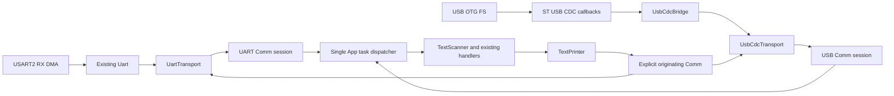

# Parallel USB CDC implementation and qualification

Status: implemented and software-tested; not physically qualified. No board was
flashed, no UART hardware baseline was captured, and no schematic was supplied.

## Architecture and invariants

UART2 remains PD5 TX / PD6 RX, 115200 8N1, no flow control, 512-byte circular
DMA1 Channel 6 RX and blocking HAL_UART_Transmit TX. Its driver, DMA settings,
interrupt priorities, 10 ms communication polling delays, command strings,
response literals and actuator handlers are unchanged. Exact wire timing under
additional USB interrupt load still requires board measurements.

The protocol is echoed CR/LF-delimited text, with CRLF treated as one delimiter.
There is no application CRC, packet header, sequence number or request ID.
The existing scanner, formatter, dispatcher and handlers are shared, not copied.
CLIManager remains unused. No USB-to-UART forwarding is performed.



### File dependency graph and integration points

```text
Core/Src/main.c -> FreeRTOS -> StartDefaultTask -> appProxy -> App
App.hpp -> Board.hpp -> Uart.hpp -> usart.h -> HAL UART / DMA
App.hpp -> UartTransport.hpp -> IByteTransport.hpp -> BufferView.hpp
App.hpp -> UsbCdcTransport.hpp -> IByteTransport / FreeRTOS task types
App.hpp -> Comm.hpp -> IByteTransport / Buffer / MutexLock / RTOS resources
App.cpp -> TextScanner / TextPrinter / existing hardware command modules
UsbCdcTransport.cpp -> usb_device.h / usbd_cdc_if.h / usbd_core.h
USB_DEVICE/App/usbd_cdc_if.c -> UsbCdcBridge.h
USB_DEVICE/Target/usbd_conf.c -> UsbCdcBridge.h -> UsbCdcTransport
OTG_FS_IRQHandler -> HAL_PCD_IRQHandler -> USBD Core -> CDC callbacks
```

| Responsibility | Existing owner / integration |
| --- | --- |
| UART byte reception | Uart::Recv, DMA CNDTR polling |
| USB byte reception | CDC_Receive_FS -> transport RX ring |
| Command framing and echo | Each independent Comm::Task |
| Pending command handoff | Comm::ReceiveCommand copies into App-owned buffer |
| Parsing and execution | App::HandleCommand(command, sourceSession), TextScanner |
| Responses | Existing TextPrinter and command handler literals |
| Reply transmission | sourceSession.SendResponse, including every help fragment |
| Startup output | Existing UART only, without delayed USB replay |
| Background output | Existing UART output plus best-effort USB mirroring |

## File-by-file implementation plan and change log

Implemented in incremental compile/test steps, without commits or changes to
existing UART/DMA source. Generated USB foundation and CubeMX metadata were
already present as user changes when implementation began and were preserved.

### New production files

| File | Purpose |
| --- | --- |
| Application/IByteTransport.hpp | Nonblocking receive, consume/copy send contract, connection state and generation-aware operations |
| Application/UartTransport.hpp | Inline delegation to the unchanged Uart driver; always logically connected |
| Application/UsbCdcTransport.hpp | Independent transport storage, diagnostics, response reservation and static RTOS resources |
| Application/UsbCdcTransport.cpp | RX/TX queues, USB service worker, lifecycle handling and C callback bridge implementation |
| Application/UsbCdcBridge.h | C-compatible interface between generated callbacks and C++ transport |

### Modified production files

| File | Change and reason |
| --- | --- |
| Application/Comm.hpp | Inject transport; optional static USB resources; per-session CR/LF and reconnect state |
| Application/Comm.cpp | Preserve framing and echo; reset USB parser on generation change; route replies and reject obsolete reservation tokens |
| Application/App.hpp | Compose UART adapter and independent USB session; declare explicit reply-session dispatch and event fanout |
| Application/App.cpp | Keep existing handlers; route every command reply to source; reserve USB reply capacity; service one USB command per application cycle |
| Core/Src/freertos.c | Remove USB initialization before App/UART objects exist; USB starts in its own optional worker after UART startup |
| USB_DEVICE/App/usbd_cdc_if.c | Bridge RX/init/deinit/completion; implement line coding; guard null class data; copy TX into persistent storage |
| USB_DEVICE/App/usb_device.c | Return on USB startup failures rather than calling global Error_Handler; clean up later initialization-stage failures |
| USB_DEVICE/Target/usbd_conf.c | Reset/suspend/resume/disconnect bridge; local clock/init failure handling; allocate endpoint 2 notification FIFO |
| USB_DEVICE/Target/usbd_conf.h | Stop advertising LPM because PCD LPM handling is disabled |

Unchanged: Application/Uart.cpp/.hpp, Core/Src/usart.c, Core/Src/dma.c,
UART/DMA IRQ handlers, TextScanner, TextPrinter, actuator modules, linker scripts
and FreeRTOSConfig.h. Existing .ioc CDC settings and descriptor identity/power
values were reviewed, not replaced. This repository tracks Debug artifacts;
CubeIDE regenerated object/dependency/stack reports, makefiles, ELF/BIN, map and
disassembly there. These are build outputs, not additional manual source edits.
Use `git status --short` for the full generated-artifact list. Existing CubeMX,
HAL USB and middleware changes present before this task were not reverted.

### New validation/documentation files

| File | Purpose |
| --- | --- |
| tests/UsbCdcTestSupport.hpp | Minimal simulated USB and RTOS dependencies for native tests |
| tests/UsbCdcTransportTests.cpp | Tests production Comm, transport and generated CDC callbacks |
| tests/run-usb-cdc-tests.ps1 | Builds/runs native tests, checks dispatcher literals/help budget and unchanged UART/DMA sources |
| USB_CDC_INTEGRATION.md | Architecture, migration record, configuration audit, results and qualification checklist |

## Session routing and concurrent control

Both interfaces have their own command buffer, CR/LF state, pending-command
semaphore and mutex. TextScanner and TextPrinter are local to the shared command
execution, not globally shared parser state. No last-active-interface variable
exists. The single existing App task executes hardware mutations serially.

Each App cycle keeps the existing UART ReceiveCommand(..., 10) call, then
services at most one USB command with timeout zero, then the existing background
tasks. Command execution may take as long as the existing handler requires;
this design does not turn blocking handlers into asynchronous operations.
Two hosts control one physical device: conflicting commands take effect in
execution order. There is no cross-interface transaction or exclusive ownership.

Command replies, help and errors go only to their originating session. UART
startup banners remain unchanged. Water-meter transitions and pulse completion
events still go to UART and are additionally mirrored best-effort to USB;
events are deliberately broadcasts, not command acknowledgements. An unread
USB host may lose mirrored events; rejection is counted in diagnostics.

## Buffering, ownership and reset behavior

RX is a 1024-byte ring. Callbacks copy each received packet, then return without
parsing, waiting or taking a mutex. The worker rearms OUT only with space for a
complete 64-byte packet; otherwise the endpoint NAKs until space is available.
Fragmented commands and multiple commands per transfer use the same Comm parser.
An impossible oversized/overflow packet increments rxOverflow and invalidates
the USB session, requiring a bus reset/reconnect rather than executing damaged
input. Existing command/token length truncation is intentionally not redesigned.

TX is a 4096-byte ring. Accepted sends copy all bytes before returning. One
64-byte-or-smaller segment is in flight; its storage remains occupied through
completion. CDC_Transmit_FS also copies into persistent UserTxBufferFS and
rejects overlength input rather than truncating. Only the transport worker
submits CDC transmissions. BUSY is retried without spinning; unconfigured/null
class data is rejected. Middleware handles exact-packet-size zero-length packets.

Before accepting a USB command for dispatch, App reserves 2048 bytes and captures
the connection generation. Current complete help plus final OK is 442 bytes.
Echo/event traffic cannot consume reserved capacity. A reservation-generation
mismatch leaves a new command pending for the next cycle rather than executing
it without reply capacity. Future response growth must remain within this
reservation; the regression runner checks current help size.

Bus reset, CDC deinit and disconnect invalidate RX/TX state and increment the
generation. Pending parser state is discarded, and old command replies cannot
enter a new session. USB peripheral reset/endpoint teardown quiesces hardware
transfers; software does not free transient caller storage. Suspend pauses the
service worker's USB I/O, retaining pending data until resume or bus reset.
With VBUS sensing disabled, physical cable loss may first appear as suspend;
the next bus reset starts a new generation. Closing a PC COM handle is not a
USB bus disconnect and, with optional DTR, is not independently detectable.

No DTR requirement is imposed: existing host documentation uses DTR/RTS low.
CDC line coding is local metadata and never changes UART baud or configuration.
There is no request replay, automatic command retry, or output-state reset on
USB connection events. A command already accepted may finish after cable loss.

## RTOS and interrupt impact

| Resource | UART / existing application | Added USB |
| --- | --- | --- |
| Command task | Existing normal-priority Comm, 4096-byte dynamic stack | Below-normal Comm, static 4096-byte stack |
| Service task | None | Below-normal USB CDC worker, static 2048-byte stack |
| Command synchronization | Existing dynamically allocated mutex/semaphore | Static mutex/semaphore control blocks |
| Buffers | Existing UART DMA and Comm buffers | Static 1 KB RX + 4 KB TX and independent command state |
| Notification | Existing pending-command semaphore | Worker task notifications from callbacks |

No additional USB allocation consumes the 16384-byte FreeRTOS heap. USB task,
mutex and semaphore creation must succeed before USB starts. The application
and UART start without waiting for USB enumeration; failures are recorded in
UsbCdcTransport::Diagnostics instead of entering global Error_Handler.

USB, UART and RX DMA IRQ priority remains 5, matching the FreeRTOS maximum
syscall priority. USB callbacks use FromISR notifications when in interrupt
context; no osDelay, mutex acquisition, heap allocation or command handler runs
there. Short BASEPRI critical sections protect transport counters and queue
copies against IRQ/task races. Their impact on UART latency must be measured.
The worker sleeps on notifications with a 10 ms retry timeout; no busy waits
are introduced in application dispatch. USB startup failures are not retried
automatically; a board restart/reinitialization is needed after a hard init fault.

## Middleware and configuration audit

Existing STM32_USB_Device_Library Core/CDC, HAL PCD/PCDEx/LL USB, generated
usb_device/usbd_desc/usbd_cdc_if/usbd_conf and OTG_FS_IRQHandler are reused.
There is no new middleware dependency and no use of UART's DMA channel.

| Item | Verified configuration / disposition |
| --- | --- |
| CubeMX | USB_OTG_FS Device Only, USB_DEVICE CDC FS; keep UART2 and DMA unchanged |
| Pins | PA11 DM / PA12 DP, AF10 |
| USB clock | HSE 8 MHz -> PLLSAI1 M=1 N=12 Q=2 -> 48 MHz; CPU/ADC clock sources unchanged |
| Supply control | HAL_PWREx_EnableVddUSB already generated; physical VDDUSB supply still needs verification |
| EP0 | Existing control endpoint / FIFO 0 retained |
| Data | CDC OUT 0x01 / IN 0x81, FS max packet 64 bytes |
| Notification | CDC IN 0x82; now allocated a TX FIFO |
| FIFO layout | RX 0x80, TX0 0x40, TX1 0x70, TX2 0x10 words; total 320 words, unchanged total capacity |
| Suspend | USB PHY gating only; PCD global low-power/STOP behavior remains disabled |
| LPM | Descriptor LPM disabled to match PCD lpm_enable=DISABLE |
| Identity | Existing ST VID 0x0483 / PID 0x5740; generic product strings retained, authorization requires product review |
| Serial | Existing MCU UID-derived serial descriptor retained |
| Power | Existing self-powered declaration and 100 mA bus draw retained pending schematic review |
| VBUS | Sensing disabled; do not assume PA9 is available for VBUS without checking the board |

CubeMX regeneration warning: review generated USB files after regeneration.
In particular, do not restore MX_USB_DEVICE_Init before App/UART startup,
global USB Error_Handler paths, the old FIFO layout, or inconsistent LPM flags.
Some modifications are outside USER CODE blocks because generated defaults
otherwise prevent correct lifecycle/failure behavior; keep this patch in version
control and reapply/review it after code generation.

## Hardware validation: blocked pending schematic and board

No schematic was available, so no electrical mismatch can be confirmed or ruled
out. Verify VDDUSB power/decoupling; PA11/PA12 continuity and polarity; Type-C
A6/B6 D+ and A7/B7 D- wiring; independent 5.1 kohm CC1/CC2 pulldowns or a suitable
Type-C controller; ESD and differential routing; VBUS presence detection;
external-power backfeed protection; self-powered declaration and bus current.
Do not connect 5 V to USB data pins. No USB PD negotiation is needed for ordinary
USB 2.0 CDC operation, but firmware cannot compensate for missing CC wiring.

## Software verification and memory

Run native tests from the project root with:

```powershell
.\tests\run-usb-cdc-tests.ps1
```

The runner needs MinGW g++ and git. If local policy blocks unsigned scripts,
use an approved process-scoped policy; it does not need administrator access.
Temporary fake headers/executable are created outside the source tree and
removed after the run. Production source is compiled directly, not copied.

Passing checks: legacy CR/LF/CRLF echo, independent command slots, fragmented
and coalesced USB input, source-only replies, TX caller-buffer ownership,
1/63/64/65/127/128/512/2048/4095/4096-byte transfers, ring wrap, BUSY retry,
reply reservation, reset during flight, stale reply rejection, reconnect between
reservation and command acceptance, suspend/resume, RX NAK backpressure,
overflow isolation, line coding, null-class TX, USB worker creation failure
and subsequent UART command processing. Dispatcher string literals and UART
driver/DMA files match the git baseline. These are simulated, not hardware tests.

The STM32CubeIDE 2.1.1 ARM GNU 14.3 Debug build links ELF/BIN successfully.
Three pre-existing misleading-indentation warnings in App::AppendStatus remain;
no new source warnings were introduced. New transport and changed USB C files
also passed focused target compilation with warnings promoted to errors.

The first successful pre-CDC build reported text=93192, data=356, bss=35996;
that reference may include the initial UART-adapter refactor. Final ELF size
was verified directly with arm-none-eabi-size, and BIN regenerated with objcopy:

| Section | Reference bytes | Final bytes | Delta bytes |
| --- | ---: | ---: | ---: |
| Text | 93192 | 100312 | +7120 |
| Initialized data | 356 | 348 | -8 |
| BSS | 35996 | 47980 | +11984 |
| Static RAM (data + BSS) | 36352 | 48328 | +11976 |
| Flash payload (text + data) | 93548 | 100660 | +7112 |

Final artifacts: Debug/ONE PRO 3 TESTER.elf and Debug/ONE PRO 3 TESTER.bin.
FreeRTOS heap stays 16 KB; added stacks/control blocks are in static RAM.
The linker provides 256 KB primary RAM plus 64 KB RAM2; RAM2 is not implicitly
available to FreeRTOS heap. Link-time RAM totals do not prove stack headroom.

## Migration and physical acceptance checklist

1. Preserve the current user CubeMX/USB changes and capture the existing UART
   firmware binary plus startup/help/echo/errors/command/event logs on hardware.
2. Review hardware and production descriptor identity/power before flashing.
3. Build the adapter and explicit routing layer; compare UART baseline logs.
4. Enable owned CDC transport and lifecycle callbacks; check enumeration and
   the same commands through a normal COM client with DTR low.
5. Verify long help, fragmented/coalesced commands and both physical Type-C
   orientations; exercise close/reopen and repeated cable unplug/replug.
6. Exercise suspend/resume and reset/disconnect during transfers, including
   exact multiples of 64 bytes; verify no stale replies after bus reconnect.
7. Use two hosts concurrently; verify source-only acknowledgements and defined
   event broadcasts while conflicting commands execute sequentially.
8. Flood USB, stop reading USB, and repeat reconnect while UART stays active;
   measure UART bytes/latency, actuator timing, minimum heap, task stack
   high-water marks and ISR/MSP stack headroom. No release until these pass.

## Residual risks and open issues

- Hardware enumeration, USB electrical compliance and 100% UART wire/timing
  compatibility cannot be claimed from source builds and simulated tests.
- Shared CPU/interrupts and existing blocking command handlers introduce timing
  coupling; serial execution is intentional, not independent devices.
- Existing UART DMA overrun detection/error recovery and silent legacy buffer
  truncation remain unchanged limitations. Keep supported command sizes.
- USB echo/event rejection is counted; background event delivery is best-effort.
  A stalled host cannot force the App task to wait for queue space.
- Future handlers must keep total per-command output within the reserved budget;
  otherwise increase the reservation/queue deliberately and add coverage.
- Both interfaces can mutate the same outputs. Neither interface disconnect
  automatically stops outputs or rolls back an already executed command.
- VID/PID permission, branding, power declarations, VBUS hardware, stack/heap
  runtime margins and baseline wire captures remain release gates.
- Host tests do not model true interrupt preemption, USB controller/FIFO timing,
  Windows driver behavior or USB reset/teardown silicon behavior.
- VS Code C/C++ still reported an unresolved IByteTransport.hpp dependency in
  App.cpp despite successful ARM compilation/linking. Refresh the editor index
  or review its include configuration separately; this is not a target build
  failure. Generated Debug output has machine-generated whitespace that is not
  manually reformatted; source-only diff hygiene is checked separately.